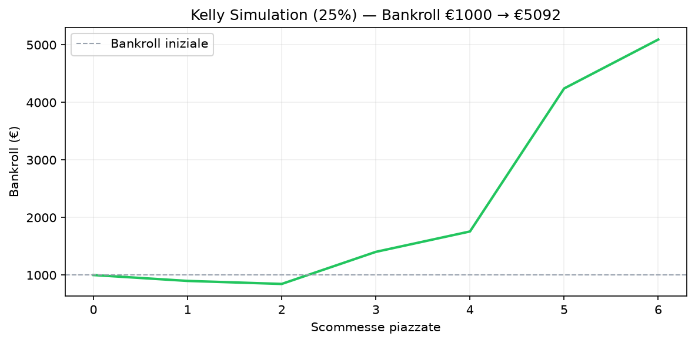
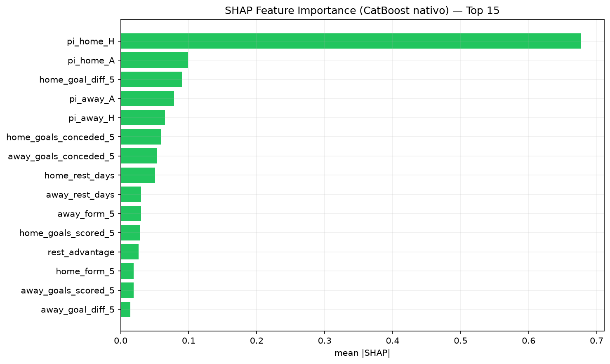
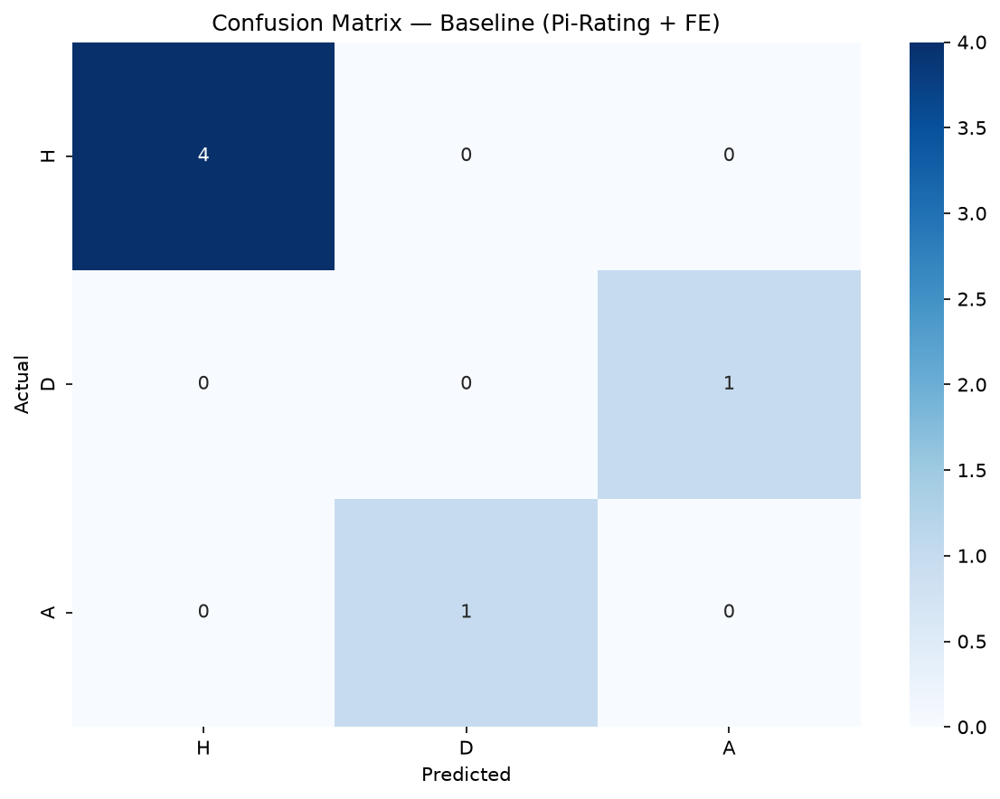

# 🏆 Report Finale — CatBoost Serie A Match Prediction

**Data**: 2026-09-26 06:36
**Modello migliore**: Baseline (Pi-Rating + FE) (`v1_baseline`)

---

## 1. Confronto Modelli

| Modello | Feature | RPS ↓ | Accuracy |
|---------|---------|-------|----------|
| Baseline (Pi-Rating + FE) | 18 | 0.0511 | 66.67% ◄ **BEST**|

---

## 2. Metriche Modello Migliore

| Metrica | Valore | Note |
|---------|--------|------|
| **Accuracy** | 0.6667 | Target > 0.52 |
| **RPS** | 0.0511 | Più basso = meglio |
| **Recall Home Win** | 100.00% | |
| **Recall Draw** | 0.00% | Classe più difficile |
| **Recall Away Win** | 0.00% | |

---

## 3. Confronto con Bookmaker Bet365

| | RPS ↓ | Accuracy |
|--|-------|----------|
| **CatBoost (v1_baseline)** | 0.0511 | 66.67% |
| **Bet365** | 0.2646 | 33.33% |
| **Delta** | +0.2135 ✅ | +0.3333 ✅ |

---

## 4. Kelly Betting Simulation (didattica, test set)

> ⚠️ Simulazione retrospettiva su dati storici: i risultati reali futuri saranno
> quasi sempre più conservativi. Kelly ridotto al 25%.

| Metrica | Valore |
|---------|--------|
| Scommesse piazzate | 6 |
| Bankroll iniziale | €1000 |
| Bankroll finale | €5092.45 |
| Profitto | €+4092.45 |
| ROI | +409.2% |
| Stake totale | 158.6% del bankroll |



---

## 4b. SHAP Analysis — Flag Neopromossa

> Mean |SHAP| misura quanto ogni feature sposta la predizione in media sul test set.
> Se ≈ 0 → il flag non porta segnale e può essere rimosso. Se `home_promoted`
> e `away_promoted` hanno valori simili → erano ridondanti, conviene unificarli.

| Flag | mean |SHAP| | Rank su 18 feature |
|------|-------------|------|
| home_promoted | 0.000000 | 17/18 |
| away_promoted | 0.000000 | 18/18 |



---

## 5. Classification Report

```
              precision    recall  f1-score   support

           H     1.0000    1.0000    1.0000         4
           D     0.0000    0.0000    0.0000         1
           A     0.0000    0.0000    0.0000         1

    accuracy                         0.6667         6
   macro avg     0.3333    0.3333    0.3333         6
weighted avg     0.6667    0.6667    0.6667         6

```

---

## 6. Confusion Matrix



---

*Generato automaticamente da `src/evaluate.py`*
