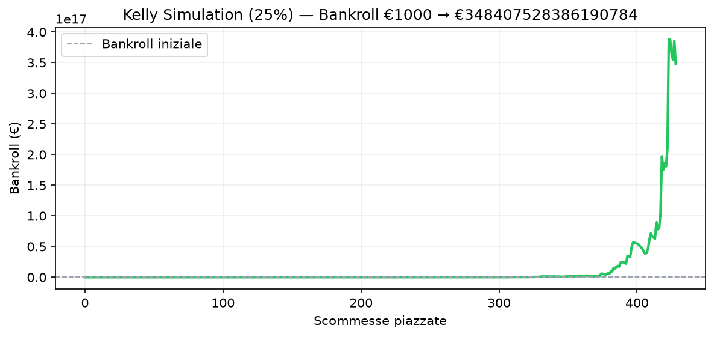
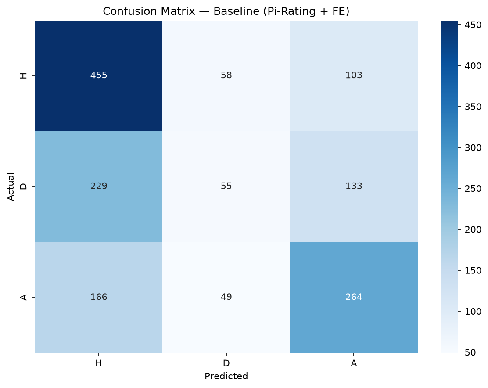

# 🏆 Report Finale — CatBoost Eredivisie Match Prediction

**Data**: 2026-11-02 14:48
**Modello migliore**: Baseline (Pi-Rating + FE) — Eredivisie (`v1_baseline`)

---

## 1. Confronto Modelli

| Modello | Feature | RPS ↓ | Accuracy |
|---------|---------|-------|----------|
| Baseline (Pi-Rating + FE) — Eredivisie | 32 | 0.1291 | 51.86% ◄ **BEST**|

---

## 2. Metriche Modello Migliore

| Metrica | Valore | Note |
|---------|--------|------|
| **Accuracy** | 0.5186 | Target > 0.52 |
| **RPS** | 0.1291 | Più basso = meglio |
| **Recall Home Win** | 78.11% | |
| **Recall Draw** | 0.00% | Classe più difficile |
| **Recall Away Win** | 60.63% | |

---

## 3. Confronto con Bookmaker Bet365

| | RPS ↓ | Accuracy |
|--|-------|----------|
| **CatBoost (v1_baseline)** | 0.1291 | 51.86% |
| **Bet365** | 0.1309 | 52.61% |
| **Delta** | +0.0018 ✅ | -0.0074 ⚠️ |

---

## 4. Kelly Betting Simulation (didattica, test set)

> ⚠️ Simulazione retrospettiva su dati storici: i risultati reali futuri saranno
> quasi sempre più conservativi. Kelly dinamico: la quota decide quanto
> Kelly pieno si prende (c_dynamic da 50% a
> 10%), con hard cap del
> 5% / 2%.

| Metrica | Valore |
|---------|--------|
| Scommesse piazzate | 403 |
| Bankroll iniziale | €1000 |
| Bankroll finale | €1905.39 |
| Profitto | €+905.39 |
| ROI | +90.5% |
| Stake totale | 408.0% del bankroll |



---

## 4b. SHAP Analysis — Flag Neopromossa

> Mean |SHAP| misura quanto ogni feature sposta la predizione in media sul test set.
> Se ≈ 0 → il flag non porta segnale e può essere rimosso. Se `home_promoted`
> e `away_promoted` hanno valori simili → erano ridondanti, conviene unificarli.

| Flag | mean |SHAP| | Rank su 32 feature |
|------|-------------|------|
| home_promoted | 0.002589 | 16/32 |
| away_promoted | 0.020474 | 17/32 |


---

## 5. Classification Report

```
              precision    recall  f1-score   support

           H     0.5259    0.7811    0.6286       169
           D     0.0000    0.0000    0.0000       107
           A     0.5066    0.6063    0.5520       127

    accuracy                         0.5186       403
   macro avg     0.3442    0.4625    0.3935       403
weighted avg     0.3802    0.5186    0.4375       403

```

---

## 6. Confusion Matrix



---

*Generato automaticamente da `src/evaluate.py`*
