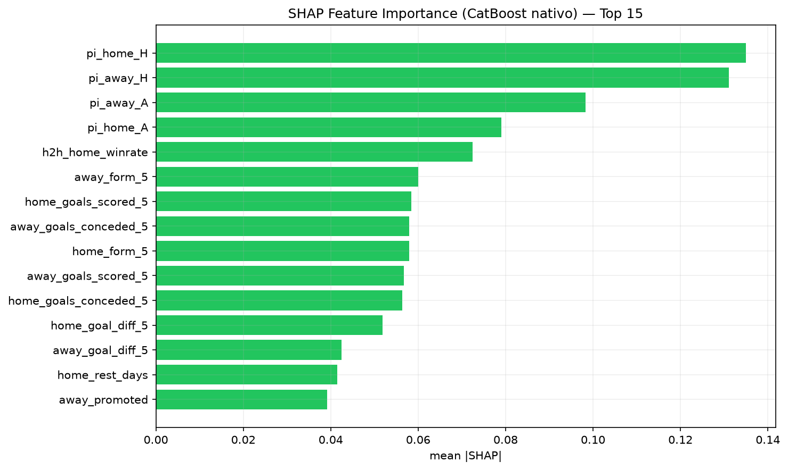

# 🏆 Report Finale — CatBoost Eredivisie Match Prediction

**Data**: 2026-11-09 15:07
**Modello migliore**: Baseline (Pi-Rating + FE) — Eredivisie (`v1_baseline`)

---

## 1. Confronto Modelli

| Modello | Feature | RPS ↓ | Accuracy |
|---------|---------|-------|----------|
| Baseline (Pi-Rating + FE) — Eredivisie | 32 | 0.1300 | 51.70% ◄ **BEST**|

---

## 2. Metriche Modello Migliore

| Metrica | Valore | Note |
|---------|--------|------|
| **Accuracy** | 0.5170 | Target > 0.52 |
| **RPS** | 0.1300 | Più basso = meglio |
| **Recall Home Win** | 76.74% | |
| **Recall Draw** | 0.00% | Classe più difficile |
| **Recall Away Win** | 62.31% | |

---

## 3. Confronto con Bookmaker Bet365

| | RPS ↓ | Accuracy |
|--|-------|----------|
| **CatBoost (v1_baseline)** | 0.1300 | 51.70% |
| **Bet365** | 0.1310 | 52.43% |
| **Delta** | +0.0010 ✅ | -0.0073 ⚠️ |

---

## 4. Kelly Betting Simulation (didattica, test set)

> ⚠️ Simulazione retrospettiva su dati storici: i risultati reali futuri saranno
> quasi sempre più conservativi. Kelly dinamico: la quota decide quanto
> Kelly pieno si prende (c_dynamic da 50% a
> 10%), con hard cap del
> 5% / 2%.

| Metrica | Valore |
|---------|--------|
| Scommesse piazzate | 412 |
| Bankroll iniziale | €1000 |
| Bankroll finale | €1634.55 |
| Profitto | €+634.55 |
| ROI | +63.5% |
| Stake totale | 379.2% del bankroll |


---

## 4b. SHAP Analysis — Flag Neopromossa

> Mean |SHAP| misura quanto ogni feature sposta la predizione in media sul test set.
> Se ≈ 0 → il flag non porta segnale e può essere rimosso. Se `home_promoted`
> e `away_promoted` hanno valori simili → erano ridondanti, conviene unificarli.

| Flag | mean |SHAP| | Rank su 32 feature |
|------|-------------|------|
| home_promoted | 0.002611 | 16/32 |
| away_promoted | 0.021288 | 17/32 |



---

## 5. Classification Report

```
              precision    recall  f1-score   support

           H     0.5238    0.7674    0.6226       172
           D     0.0000    0.0000    0.0000       110
           A     0.5062    0.6231    0.5586       130

    accuracy                         0.5170       412
   macro avg     0.3434    0.4635    0.3938       412
weighted avg     0.3784    0.5170    0.4362       412

```

---

## 6. Confusion Matrix


---

*Generato automaticamente da `src/evaluate.py`*
