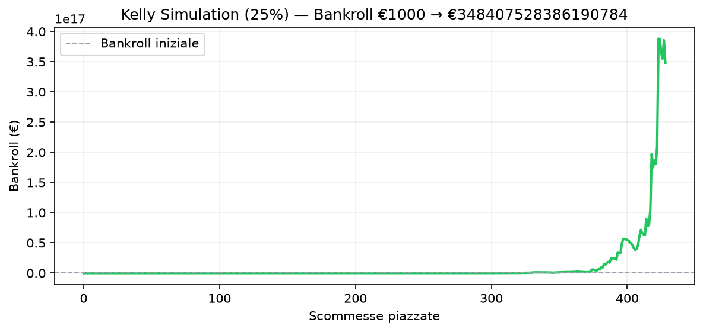
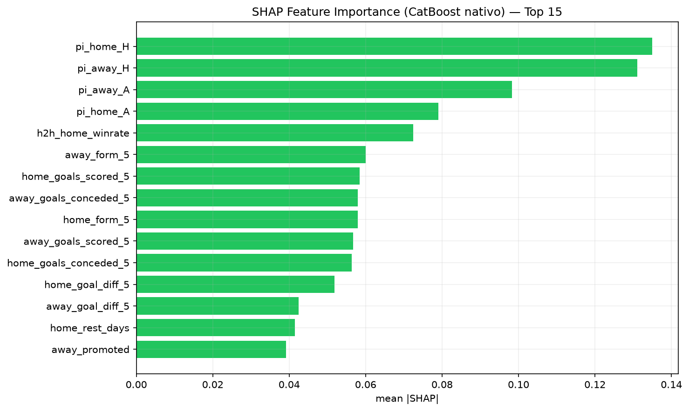
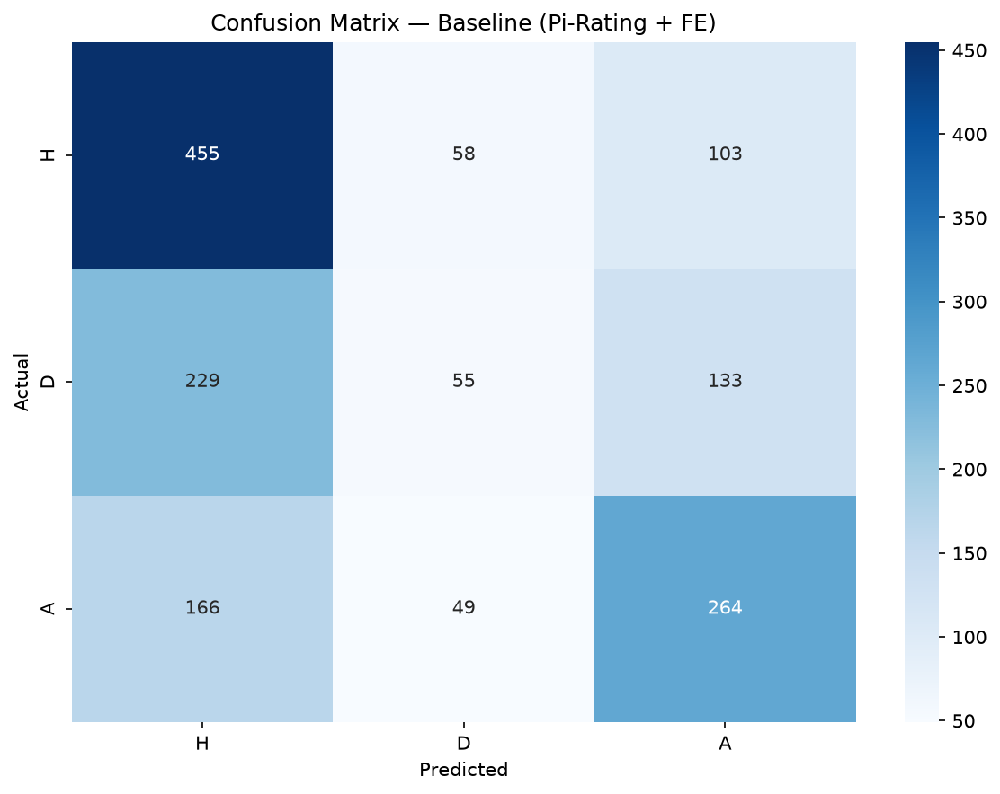

# 🏆 Report Finale — CatBoost Serie A Match Prediction

**Data**: 2026-10-19 12:05
**Modello migliore**: Baseline (Pi-Rating + FE) — Serie A (`v1_baseline`)

---

## 1. Confronto Modelli

| Modello | Feature | RPS ↓ | Accuracy |
|---------|---------|-------|----------|
| Baseline (Pi-Rating + FE) — Serie A | 17 | 0.1422 | 49.32% ◄ **BEST**|

---

## 2. Metriche Modello Migliore

| Metrica | Valore | Note |
|---------|--------|------|
| **Accuracy** | 0.4932 | Target > 0.52 |
| **RPS** | 0.1422 | Più basso = meglio |
| **Recall Home Win** | 67.05% | |
| **Recall Draw** | 14.55% | Classe più difficile |
| **Recall Away Win** | 53.95% | |

---

## 3. Confronto con Bookmaker Bet365

| | RPS ↓ | Accuracy |
|--|-------|----------|
| **CatBoost (v1_baseline)** | 0.1422 | 49.32% |
| **Bet365** | 0.1789 | 37.21% |
| **Delta** | +0.0367 ✅ | +0.1210 ✅ |

---

## 4. Kelly Betting Simulation (didattica, test set)

> ⚠️ Simulazione retrospettiva su dati storici: i risultati reali futuri saranno
> quasi sempre più conservativi. Kelly dinamico: la quota decide quanto
> Kelly pieno si prende (c_dynamic da 50% a
> 10%), con hard cap del
> 5% / 2%.

| Metrica | Valore |
|---------|--------|
| Scommesse piazzate | 438 |
| Bankroll iniziale | €1000 |
| Bankroll finale | €9485525.74 |
| Profitto | €+9484525.74 |
| ROI | +948452.6% |
| Stake totale | 1308975.0% del bankroll |



---

## 4b. SHAP Analysis — Flag Neopromossa

> Mean |SHAP| misura quanto ogni feature sposta la predizione in media sul test set.
> Se ≈ 0 → il flag non porta segnale e può essere rimosso. Se `home_promoted`
> e `away_promoted` hanno valori simili → erano ridondanti, conviene unificarli.

| Flag | mean |SHAP| | Rank su 17 feature |
|------|-------------|------|
| home_promoted | 0.030711 | 16/17 |
| away_promoted | 0.036767 | 17/17 |



---

## 5. Classification Report

```
              precision    recall  f1-score   support

           H     0.5221    0.6705    0.5871       176
           D     0.2759    0.1455    0.1905       110
           A     0.5325    0.5395    0.5359       152

    accuracy                         0.4932       438
   macro avg     0.4435    0.4518    0.4378       438
weighted avg     0.4639    0.4932    0.4697       438

```

---

## 6. Confusion Matrix



---

*Generato automaticamente da `src/evaluate.py`*
